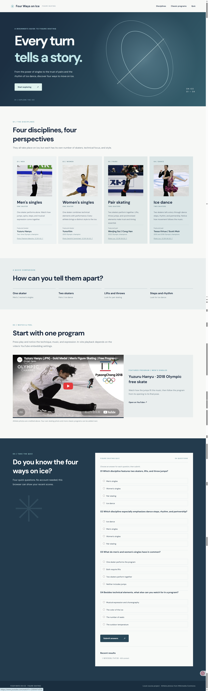

# 冰上四重奏 · 花样滑冰课程项目

一个介绍男单、女单、双人滑和冰舞的网站。访客可观看节目视频、回答四道趣味题；Python 后端评分，并把最近成绩存到数据库。本机直接运行时使用 SQLite；Docker Compose 使用本机 PostgreSQL；云端将使用 Azure Database for PostgreSQL。

## 网站预览



## 在 VS Code 中运行

1. 用 VS Code 打开 `figure skating` 文件夹。
2. 打开终端，运行 `python server.py`。
3. 浏览器打开 <http://localhost:8000>。
4. 完成问答后刷新页面；最近成绩应仍然显示。

也可以用 VS Code Live Server 打开 `web/index.html`。建议在浏览器地址栏使用 `http://localhost:5500/web/index.html`：目前嵌入的 YouTube 视频在 `127.0.0.1:5500` 下可能显示无法观看，而同一页面在 `localhost:5500` 下已验证可以播放。页面样式在两种地址下都能加载。若要使用问答和历史记录，仍需在另一个终端运行 `python server.py`，因为 Live Server 只提供静态文件，不运行 Python API。

不需要安装 Python 扩展包或单独安装数据库。Python 自带 SQLite，首次答题时自动建立 `data/skating.db`。请勿把此文件上传到 Git。

## 使用 Docker 在本机运行

先启动 Docker Desktop，然后在 `figure skating` 文件夹的终端运行：

```powershell
docker build -t figure-skating-api .
docker run --rm -p 8000:8000 figure-skating-api
```

打开 <http://localhost:8000> 检查网页，完成一次问答，确认 API 可以保存并显示成绩。按 `Ctrl+C` 停止容器。当前容器内仍使用临时 SQLite：容器删除后成绩会丢失。这一步只验证容器运行；正式云部署前要改为云托管数据库。

## 在本机连接 PostgreSQL

1. 把 `.env.example` 复制为 `.env`，并把其中的示例密码换成你自己的密码。`.env` 已被 Git 忽略，不会上传到仓库。
2. 启动 Docker Desktop，在本文件夹运行 `docker compose up --build -d`。
3. 打开 <http://localhost:18000>，完成一次问答并查看成绩。运行 `docker compose down` 后重新启动，成绩应该仍在。

Compose 会同时运行 API 和 PostgreSQL。数据库数据保存在 Docker 卷中，所以普通的 `docker compose down` 不会删除成绩。需要完全清空测试数据时才运行 `docker compose down -v`。这里的 PostgreSQL 仍在你的电脑上，**不是**老师要求的云托管资源。

## 云端连接准备

网页和 API 部署到不同网址后，需要互相知道地址：

- 在 Azure Container App 的环境变量中设置 `CORS_ORIGIN` 为静态网站的完整网址，例如 `https://example.z22.web.core.windows.net`。这允许该网页在浏览器里调用 API。
- 在 `web/config.js` 中设置 `window.FIGURE_SKATING_API_BASE` 为 Container App 的公开网址，例如 `https://example.azurecontainerapps.io`。部署前再填真实地址，不要填数据库密码。
- 云端 API 使用 PostgreSQL 时，设置 `PGHOST` 为服务器终结点、`PGPORT=5432`、`PGDATABASE=postgres`、`PGUSER` 为管理员登录名、`PGSSLMODE=require`。将 `PGPASSWORD` 保存为 Container App 的 Secret，并让同名环境变量引用它；不要写进 Git。已有的 `DATABASE_URL` 配置方式仍可用于本地 Docker Compose。`GET /api/health` 可用于检查 API 是否在运行。

云端部署已完成：静态网页位于 Azure Blob Storage `$web`，Python API 以容器运行在 Azure Container Apps，答题记录保存在 Azure Database for PostgreSQL Flexible Server。公开网页：<https://figureskatingingrid.z43.web.core.windows.net/>。API 公开地址已写入 `web/config.js`；数据库密码只保存在 Container App 的 Secret 中。已从公开网页完成答题提交，并看到最近成绩。

## 当前结构

- `web/`：静态网页（HTML、CSS、JavaScript）。
- `server.py`：网页服务器、问答接口和成绩读写；本机默认 SQLite，云端使用 PostgreSQL。

## 提交前检查

页面展示四张 Wikimedia Commons 运动员照片，每张照片下方都有作者、许可和原始文件页链接；图片目前由 Wikimedia 远程加载，需要联网。

提交前在公开网页完成一次答题，刷新页面并确认最近成绩仍然显示；在 Azure 门户核对存储帐户、Container App 与 PostgreSQL 服务器。录制 2–3 分钟视频，展示完整流程、三个资源、遇到的问题及解决办法，以及生产环境改进。提交 Git 仓库链接、云资源截图和视频链接。

答题记录不需要注册登录：浏览器生成随机编号，API 按编号查询历史。清除浏览器本地数据后，原记录不会再显示；这不是账户系统，也不适合存私人信息。
